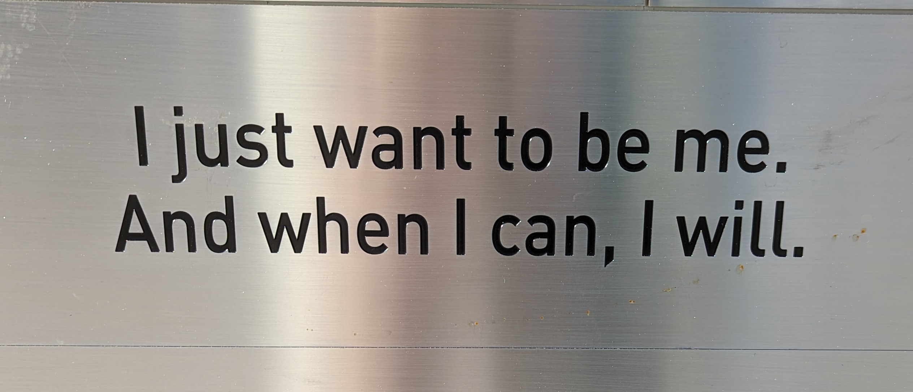

## kekspuh

Personal project to learn Python. Motivation was from another spotify user who created playlists based on KEXP 90.3 FM
airplay and daily programming. Unfortunately, the playlists became unavailable in October 2026, so I figured it was
time I learn how to do it.

### Overview

*kekspuh* aims to build a system for fetching, storing, matching spotify URIs, creating spotify playlists, and
potentially generating trivia/facts from data retrieved from the KEXP.org API. I am currently focused on the backend
development, with the goal of ingesting data and storing it in a SQLite database. Future plans include creating a simple
streaming website to display real-time plays and trivia.

### v0.3.0-alpha Changelog

- Discovered that Spotify limits API calls by both rate ***and*** quota, requiring a rewrite of ingestion logic
- Attempted to wrap httpx calls/requests (not sure exactly, still learning) to limit TCP connections while calling
  Spotify endpoints to prevent unnecessary translations
- Spoti-Pie (`spottuh.py`): created an API call log that tracks Spotify search and playlist edit API calls in a 24hr
  rolling window. Purpose is to test what the API quota is, and adapt future versions from exceeding the quota
- `cli_entry`: added options to poll remaining KEXP endpoints (`hosts`, `programs`, `timeslots`). Bifurcated previous
  options between ingesting substantial amounts of KEXP endpoints and Spotify search and playlist edit API calls
- `db_functions.py`:
    - Added new functions to limit playlist edit API calls: de-duplicate playlist entries if a track is
      recently repeated; only edit playlists with previously-matched tracks to prevent simulatneous search and playlist
      edit calls
    - Discovered and corrected a database integrity issue due to unique constraints in Spotify track, album, and artists
      matches. This required dropping and re-creating Spotify tables in the database. Learned what Little Bobby Tables'
      mom actually did to his school's database ([xkcd 327](https://xkcd.com/327/))
- `spot_match.py`: limited "catch-up" functions (ingest historical KEXP endpoints created while not polling) to only
  update Spotify playlists with the most-recent trackplay
- `pyproject.toml`: bumped `pyrefly` and `ruff` versions

### Current Status

- **Versioning**
    - With a working manual process, bumped to v0.2.0-alpha.
    - Began automated matching and playlist updates, bumped to v0.3.0-alpha
        
- **Backend**:
    - Implemented a Python-based ingestion engine that fetches data from several KEXP.org API endpoints: hosts, plays,
      programs, shows, and timeslots.
    - A manual "backfill" process progresses through the endpoints, which go back to 2001. Endstate will be a database
      of about 3.8 million trackplays.
    - Multiple "forward fill" processes to ingest plays from the latest airdate in database to current; match tracks,
      albums, and artists with spotify URIs; and updates one or more playlists based on a few simple rules:
        - Eva Walker's Early Show
        - John Richards' Morning Show
        - Larry Mizell, Jr.'s Afternoon Show
        - Evie Stokes' Drive Time
        - Troy Nelson's guest DJ sets
    - Last will be tucking the app away on a local server with a polling daemon keeping everything updated.
        
- **Database**:
    - The schema includes unique indexes to ensure data deduplication and satisfactory performance.
    - Tables are structured to handle relationships between shows, DJs, artists, labels, albums, tracks, plays, spotify
      URIs, current spotify playlists status, and other endpoint metadata (including active DJs, programs, and
      timeslots).
    - Holy crap, databases, foreign keys, indexes, junction tables... my mind is mush from trying to figure that out.
        
- **Data Handling Functions**:
    - I tried my best to de-duplicate and store data in my preferred formats. Only took me forever (I'm a writer, not a
      programmer). Solving puzzles with python is re-wiring my brain, but it's fun to find solutions. My favorite was
      accounting for all the "Bob McKenzie feat. Doug" artist fingerprints so a track with the same artists will always
      be deduplicated by parsing and delimiting MusicBrainz artist fingerprints in alpha order.
    - The meat of the ingestion—the`save_batch` function—handles batch insertion of records and their associated
      metadata. My first less-than-ametuer attempt caused a single-table 5GB database that took ~1min to perform one
      query... and that is when I learned about relational databases.
        
- **API Integration**:
    - The project integrates with the spotify api to handle user authentication and playlist manipulation using their
      "authentication flow". Pretty cool learn what happens when I—as a user of others software—get redirected from apps
      to providers to login and authorization access to my various accounts. Functions like `get_valid_access_token`
      manage tokens for secure access using local environment variables.
    - My partner humored me when I ran across the house and told her, "I logged myself in to my own app!"

### REAL Current Status

- **No Idea if This Works**... in the long-term. After proof-of-concept, I refactored the "plays" endpoint ingestion and
  added the other endpoints; split modules into distinct functions, and pulled my hair out (what's left of it) figuring
  out the database (I needed to make mermaid flowcharts to understand it).
- **Small Idea that It May be Working**... in the short-term.

### UNREAL Current Status

- An old video game from 1998.

### GoldenEye 007 Current Status

- Still the best multiplayer FPS of all time

### Next Steps

- ~~**Other Endpoints**:~~
    - ~~There are several other endpoints I would like to ingest that will greatly expand data for trivia, including v1
      endpoints:~~
        - ~~[KEXP API](https://api.kexp.org/v2/)~~
        - ~~[Legacy API](https://api.kexp.org/v1/) (no need for this)~~
            
- **Trivia/Facts Generation**:
    - Develop algorithms to generate trivia questions or interesting facts based on the ingested data: "Troy Nelson
      plays <track> more often on Tuesdays that any other day; but if it is raining during his show, he typically
      plays <band's> cover of the song."
        
- **Streaming Website**:
    - Create a web interface to display real-time streaming results and trivia/facts. I will attempt to use my
      non-existent design skills... wish me luck.
        
- **Testing and Optimization**:
    - Implement comprehensive testing to ensure data integrity and system reliability... heh, just kidding. I have no
      idea how to test yet.
    - Never stop optimizing ~~Optimize~~ database performance and API calls for efficiency, I WILL CONTINUE TO LEARN
      ~~NEED TO BETTER LEARN~~ THE SYNTAX TO YELL AT MY DATABASE AND FIGURE OUT WHERE MY INEFFICIENCIES ARE;
        
- ~~**Spotify Matching**:~~
    - ~~Get a Spotify matching function going to slog through millions of plays and match track, album, and artist
      Spotify URIs.~~
        
- **Comments**
    - Future me is going to appreciate knowing what past me did (Nov 22, 2026: sorry future me, I am still
      procrastinating)

---

[KEXP 90.3 FM](https://www.kexp.org/) is a Seattle-based non-profit radio station founded by University of Washington
students in 1972 as KCMU 90.5 FM. KEXP also broadcasts as KEXC 92.7 FM in Alameda / San Francisco, CA. About 61% of the
station's income comes from ~36,000 worldwide donors, totaling ~$17MM in 2025. I've been donor for about 20 years, and a
friend and I are memorialized on the station's new home in Seattle Center: a line from my favorite song, and our band's
name from back in the day.

---

  

The Smashing Pumpkins — <i>Mayonaise</i>, Siamese Dream (1993)

---

  

Wookey Hole (late-90s)

